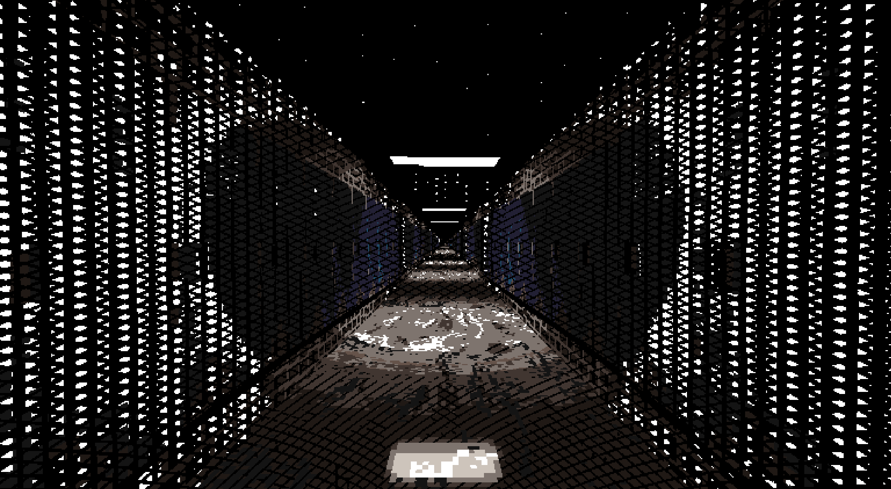
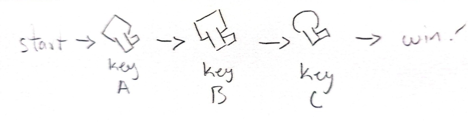
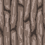
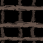
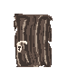
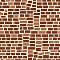
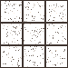
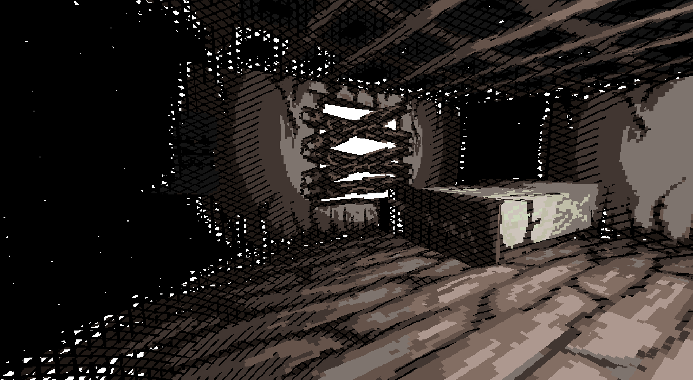
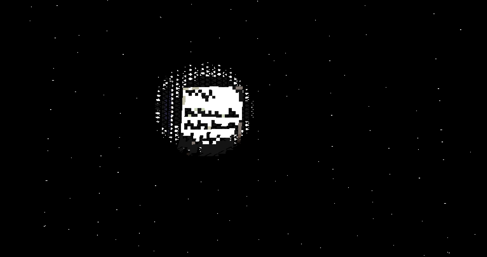

# FUN HOUSE [replace with logo]
### An Escape-Room Puzzle Game made in Godot 

## Development Team:
**Russell R. Cannon** - Art, Shaders, Room Construction Logic, Sound Manager, Menu Art, Settings, Room 2

**Patrick Murphy** - Main Menu Layout and Logic, Note System, Sounds, Room 3

**Bernardo Mejia** - Object Interaction System, Player Movement, Room 2

**Heriberto Dominguez** - Art, Music, Shaders, Game Design Lead, Room 3

## Overview
***FUN HOUSE*** is a simple escape-room puzzle game. The player's goal is to find an exit out of an unwinding, unending nightmare. Find notes, decipher who you may be, use "keys", and...

*wake up...*

## Game Design and [Game Design Document](https://coloradomesa365-my.sharepoint.com/:w:/g/personal/bdominguez_mavs_coloradomesa_edu/IQBb6ev-psimTppUSgUetgVwAcgUAhYSrP-sZKpfuTde_m4?e=hPDIic)

Our team made extensive use of a Game Design Document to keep the design and implementation of our game aligned with our initial vision and goals. The Design Document also helped keep us within scope.

### **Requirements**
- The player is set to navigate a 1x1ft grid, with left and right turns being 90 degrees. Base wall collision checks to prevent wall/object clipping.

- Interactions are limited to a single button press. This helps keep interactions intuitive and easy to learn for the player.

- A Room Builder tool to easily make rooms, lessening level development time.

- Simple object and interactable's system to make object interactions modular during development.

- Three rooms, each with a different theme, providing simple yet entertaining levels.

### **Gameplay**
The player navigates 3D space on a grid, collecting "keys" to open the next door and progress to the next room. Every room has a different, unique way of implementing "keys", so *what is a key in our game?*

**A "key" is any object, clue, or concept that allows the player to continue progressing through the game.**

Each key must be obtainable after the previous key, and before the next key. To achieve this, every level must use up their key before moving to the next room, and each key must be confined to its respective room.

### **Art**
To keep within scope, we applied a pixelated style for our textures, using a texel-space shader to clamp lighting to each pixel, and few 3D models. Surface textures are 75x75px in size. Some textures had normals to give a sense of depth.

        

  

We make extensive use of 2D sprites in 3D space, safe for objects with collision or interactable surfaces (ex. the cabinet, locker, and fuse box).

A post-processing hashing texture combined with posterized lighting and a limited palette completes a retro aesthetic fitting of the game.

 

# Check out the [Game Design Document](https://coloradomesa365-my.sharepoint.com/:w:/g/personal/bdominguez_mavs_coloradomesa_edu/IQBb6ev-psimTppUSgUetgVwAcgUAhYSrP-sZKpfuTde_m4?e=hPDIic) for more details.